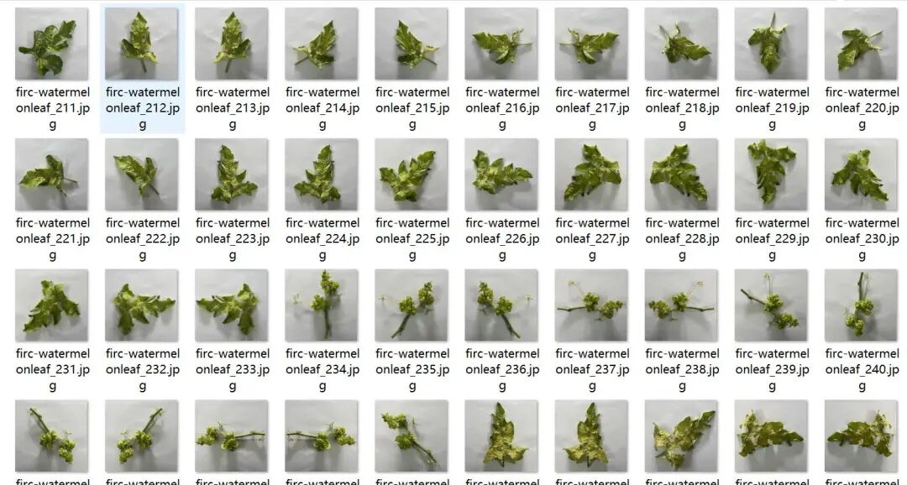
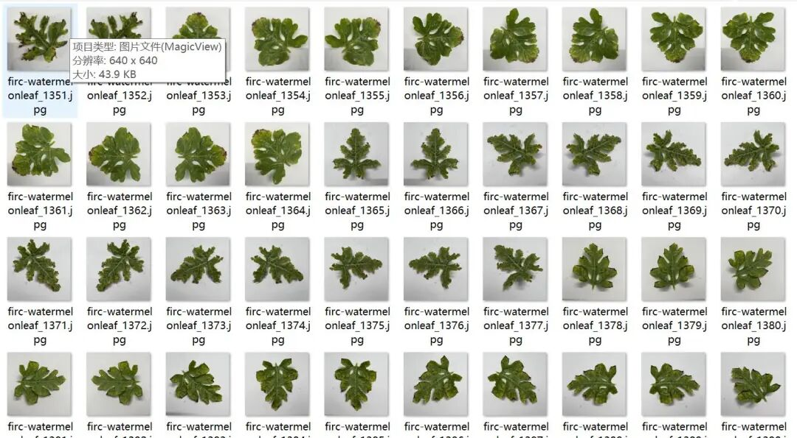
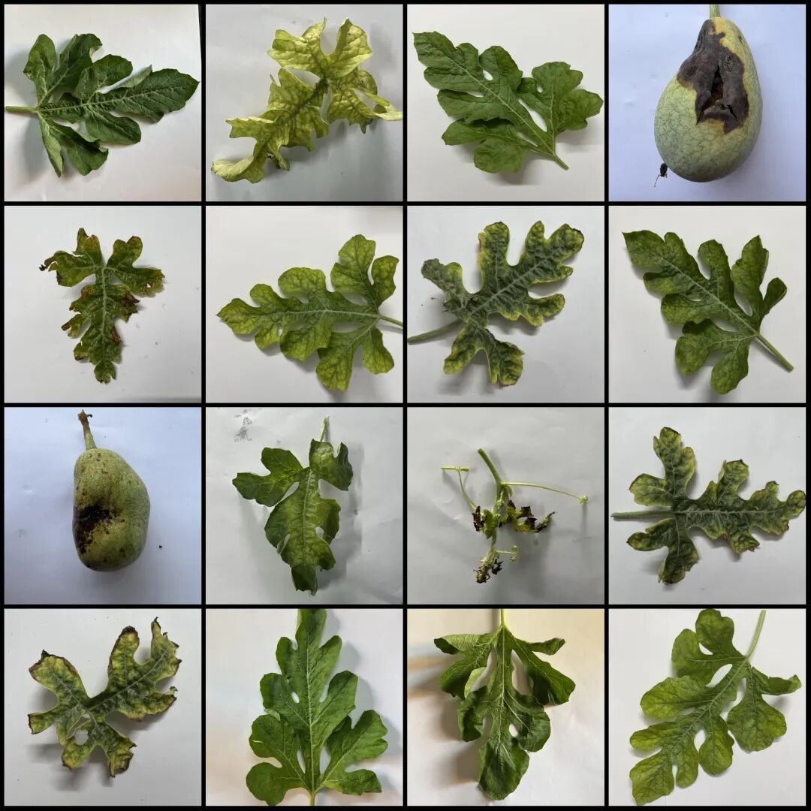
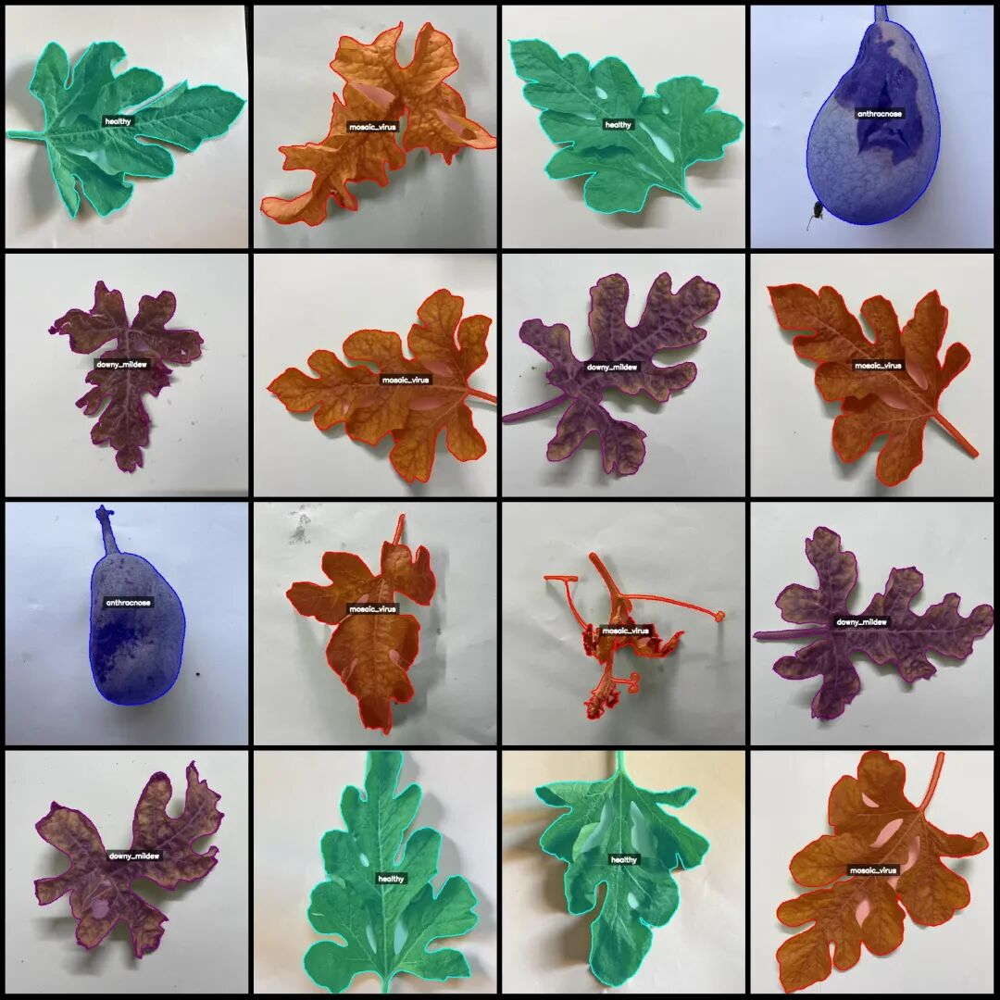
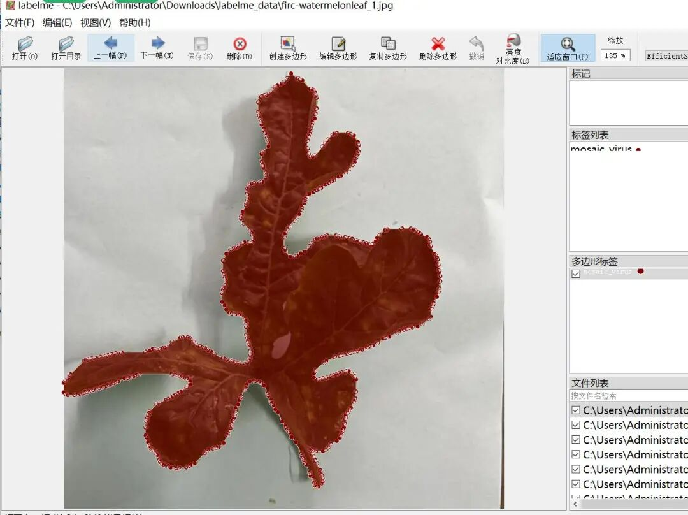

# Melt-in-One Dataset for Disease Identification and Segmentation of Watermelon Leaves in LabelMe format with 1738 images across 4 categories

Dataset format: labelme format (without mask files, only including jpg images and corresponding json files)

Number of images (number of jpg files): 1738

Number of annotations (json file count): 1738

Labeling category count: 4

Label category names: ["mosaic_virus", "healthy", "downy_mildew", "anthracnose"]

Number of boxes labeled in each category:

mosaic_virus (leaf-bud mosaic virus) count = 630

Healthy (health) count = 298

downy_mildew (powdery mildew) count = 576

Anthracnose (Mycosis) count = 237

Total frame count: 1741

Using labeling tool: labelme=5.5.0

Image resolution: 640x640

Annotation rules: Draw polygons around the categories.

Important Notice: The dataset can be opened and edited using LabelMe. For JSON datasets, one must convert them into mask or Yolo formats for semantic segmentation or instance segmentation.

Special : This dataset does not guarantee the accuracy of the trained models or weight files.

Image Preview:

Annotation example:

Original image (randomly select 16 images to display):

Annotation:

LabelMe editing example:

## Payment

Here is a pay link on Stripe ( https://buy.stripe.com/3cs8yP7sY87d0vu9AB ). Please contact me lonlonago@foxmail.com after funding $89, and I will send you a complete data files , thank you!

